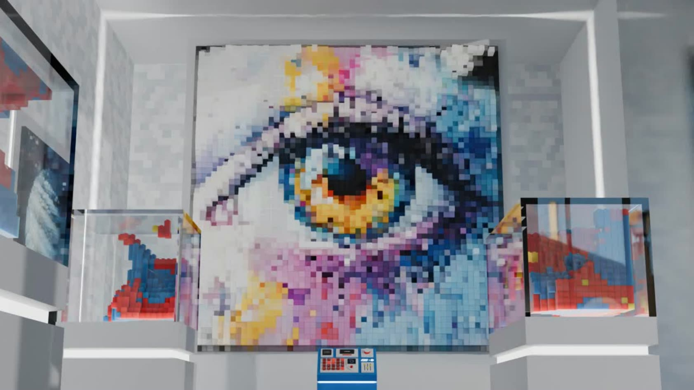
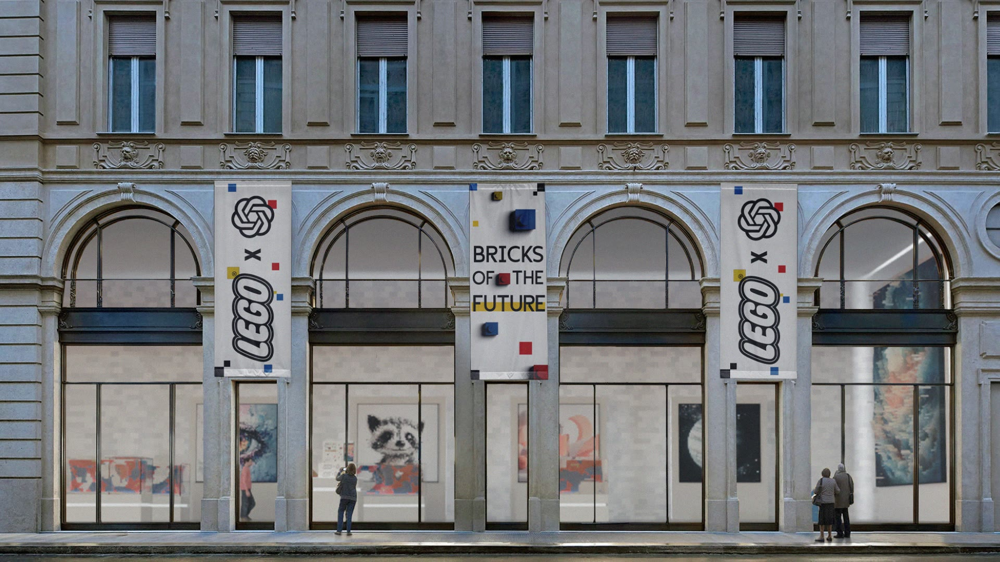
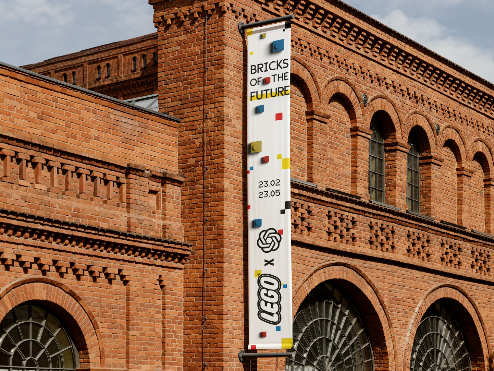
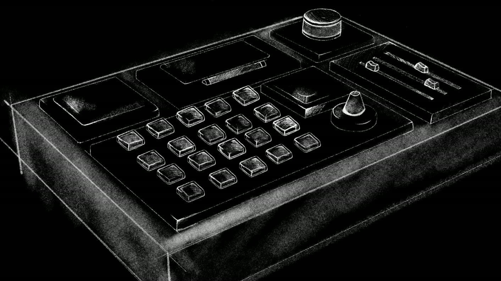
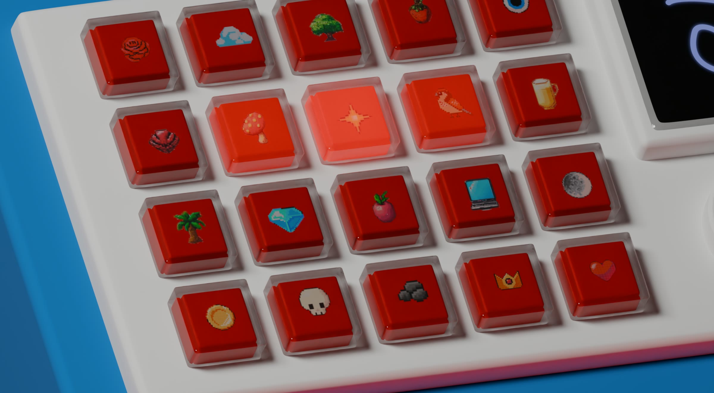
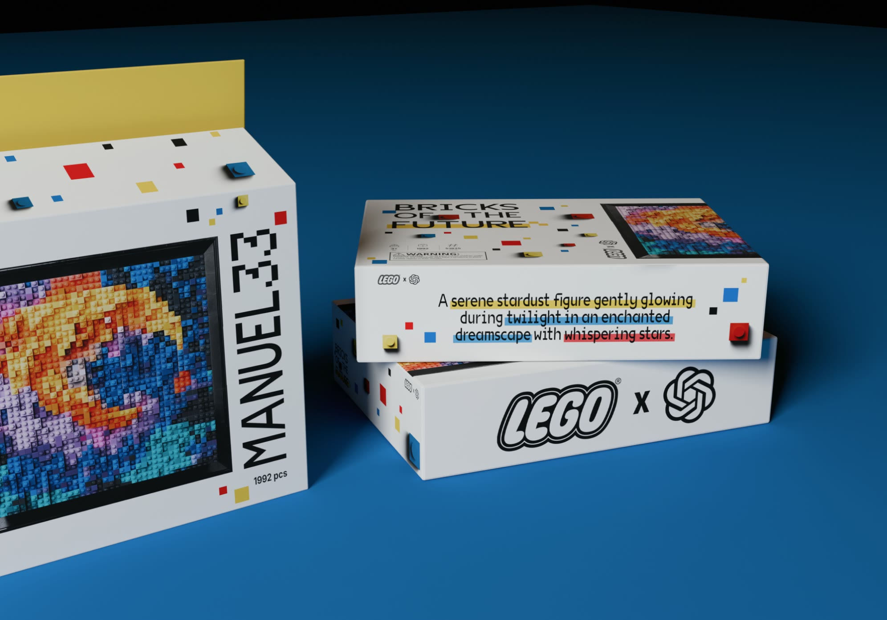
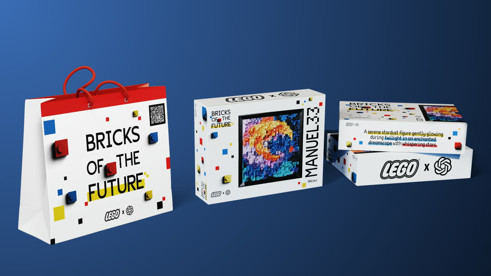
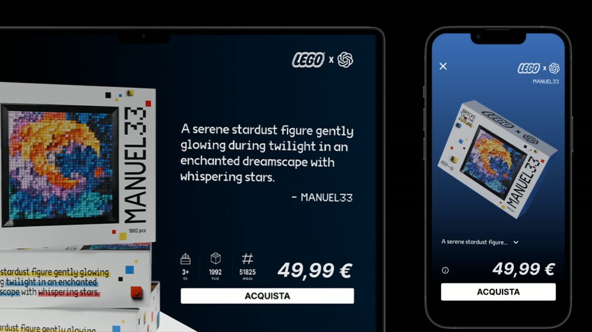

# A sentence you can build.

> An academy brief: LEGO meets OpenAI in Bricks of the Future, a museum where a sentence goes home as a box of bricks.

A generated picture weighs nothing. It lands on a screen, and the next one replaces it.

A LEGO box is a picture too. It comes with the pieces to make it real.

We designed a museum where one turns into the other.



## The way in



The poster gives it a place and three months: Palazzo Marignoli in Rome, 23.02 to 23.05.

The identity is a scatter of pixels in brick colours. A few of them have studs. That's the whole idea at poster size: the screen, turning into bricks.



## No keyboard

Every work starts at one console. We gave it no keyboard.



A sentence is already on the screen, with two words left open. You don't write a prompt here. You tune one.


Nobody needs to know what a prompt is.



## Out of the screen

The result isn't a picture on a screen. It's a picture in bricks: a mosaic for the wall, or a sculpture for a glass case.


```logic
VISITOR                     MACHINE

a sentence
│ two words left open
▼
keys · dials · faders ────▶ openai
                            │ draws the picture
                            ▼
                            the picture, in bricks
                            │ a mosaic or a sculpture
                            ▼
                            the box
                            │ prints the sentence
                            │ and the name
hands, at home ◀────────────┤
│ brick by brick            │
▼                           ▼
the sentence, built         the portal
                            │ anyone can buy the work
```

==The machine draws it. You build it.==

## The box

The work would leave the museum in a box, printed for one visitor.


> A serene stardust figure gently glowing during twilight in an enchanted dreamscape with whispering stars.

In the mock-up, that's the visitor's sentence. It goes on the side of the box, set like a title. Their name goes on the front: MANUEL33.



Inside are the bricks to build it at home. This one takes 1992.



## The portal

The works wouldn't stay in the museum. A portal made for the event would sell them to anyone.

In our mock-up, each product page quotes its sentence and signs it with the visitor's name.



We designed a shop where every product has an author: a visitor.

---

Academy project, AANT, BA in Art Direction. [index](../index.md)
