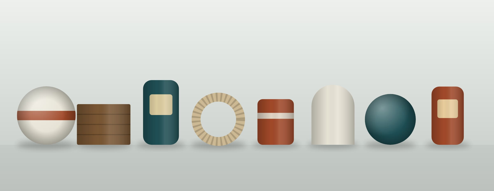
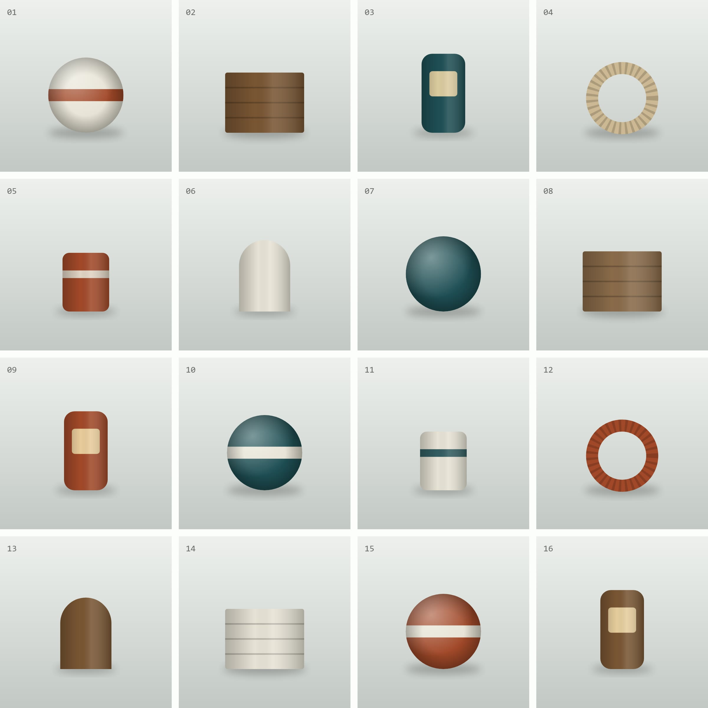

# Direction as code.

> A style guide machines can follow.

Generated assets drift. Forty prompts, forty different studios.

==What if the art direction were the input, not the review?==



## Logic

```logic
ME                          MACHINE

brief
│
▼
direction file ───────────▶ claude code
▲                           │ writes the prompts
│                           ▼
│                           comfyui · meshy
│                           │ 160 candidates
│                           ▼
│                           blender
│                           │ renders the sheet
│                           ▼
└── the eye ◀───────────────┘
    keeps 40 · 2 redirects
```

The prompts are output. **The file is the work.**

```yaml
world: "a lighthouse keeper's island, 1970s"
palette: [salt white, rust, deep teal, oiled wood]
materials: worn, matte, nothing new
shapes: rounded, heavy bases, no sharp chamfers
never: chrome, neon, plastic gloss
check: silhouette reads at 64 px
```

## Proof




**40** kept of 160. **1** direction file. **2** redirects. Machine 46 min, me 5 h.

The two redirects are commits to the direction file.

```log
a3f9c21  redirect: heavier bases, silhouette check at 64 px   Nov 21
7be02d4  redirect: never chrome, neon or plastic gloss        Nov 19
1c4d8e0  direction file, first draft                          Nov 18
```

## Credits

- Machine: Claude Code, ComfyUI, Meshy, Blender (scripted)
- Me: the idea, the brief, the direction file, every cut, both redirects

---

[index](../index.md)

<!-- Sample case. The numbers and commits are placeholders for the draft. -->
