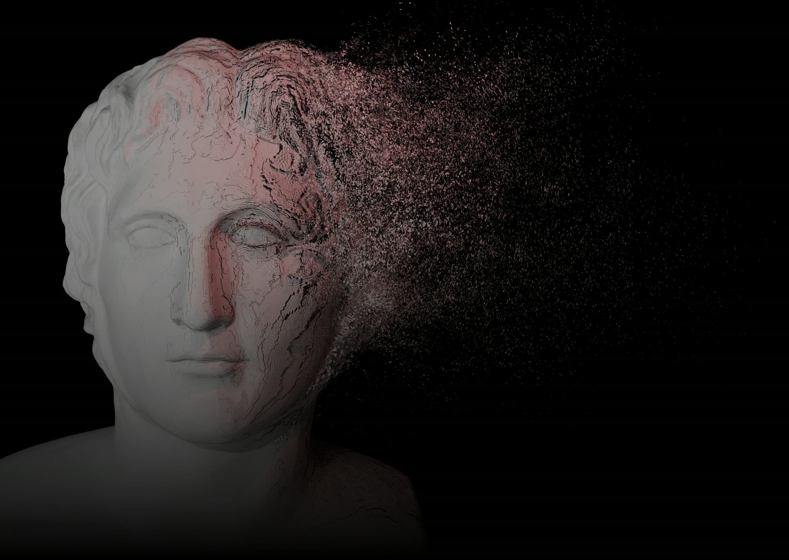
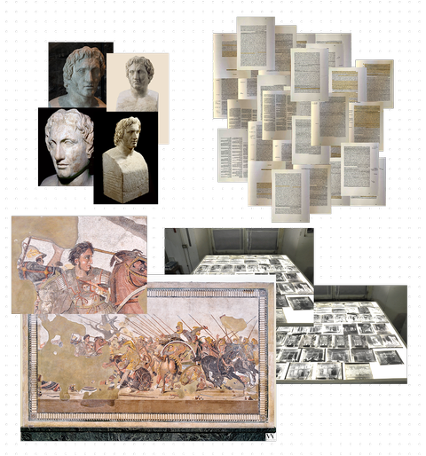
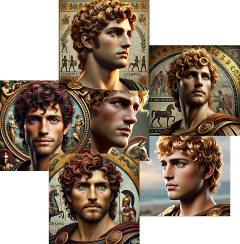
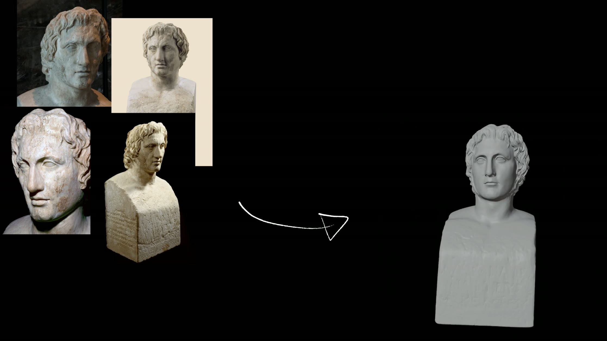
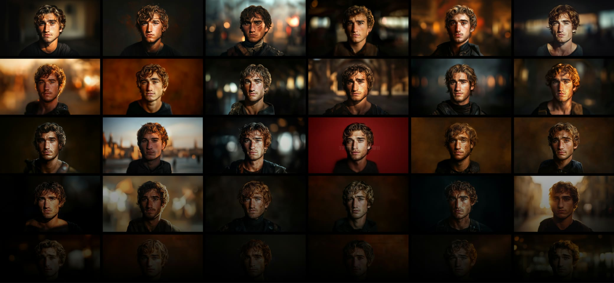
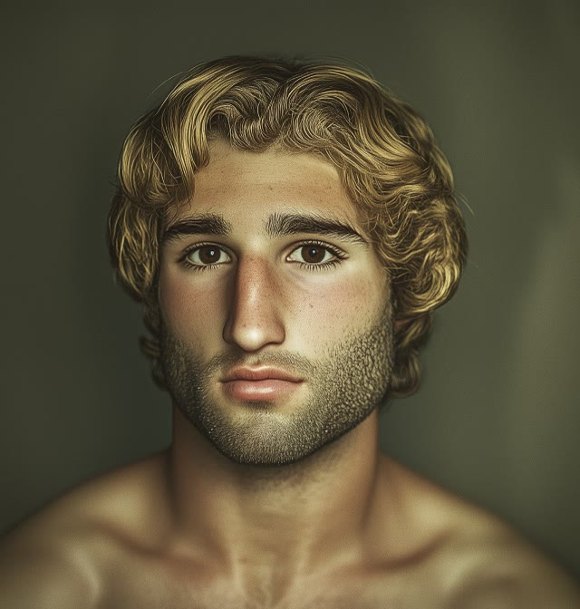

# A face, from fragments.

> An academy project with RAI Cultura: the search for Alexander the Great's true face, with AI, for a documentary that aired on Rai 5.



Nobody alive has seen Alexander the Great's face.

The machines think they have.

The documentary is about the Alexander Mosaic. Our part was the face.

What survives of it comes in fragments.



## The machine's Alexander

ChatGPT helped us read the sources and write the first prompts.

The images came back from Hollywood. Diffusion models picture the heroes of the past as modern, plastic film stars.



> The model knew the sculptor's name. Not Alexander's face.

==Words drift. Geometry holds.==

```logic
US                          MACHINE

the official archives
│
▼
research ─────────────────▶ chatgpt
                            │ the first prompts
                            ▼
                            diffusion models
                            │ a Hollywood Alexander
                            ▼
the eye ◀───────────────────┘
│ too modern, too plastic
▼
the marble portrait
│ I take charge of
│ the 3D model
▼
shots of the model ───────▶ diffusion, guided
                            │ the face holds
                            ▼
the face ◀──────────────────┘
│ I remap it in blender
▼
the textured head ────────▶ runwayml act-one
                            │ the face moves
                            ▼
the final cut ◀─────────────┘
  from mosaic to face
```

## The marble's Alexander

Truer, more detailed faces needed something fixed to stand on.

I took charge of the 3D model every later generation was built on.




Shots of the model guided every face that followed.





## The marble speaks

I remapped the face onto the 3D model in Blender.


That gave me a reliable base for video with RunwayML Act-One.


## From the mosaic to the face

We made the final clips with RunwayML and cut them together.


## The mosaic's journey

Alongside the face, we set the archive in motion with RunwayML.


## On air

Il volto di Alessandro, the restoration of the mosaic of Alexander and Darius. Previewed at MANN, the National Archaeological Museum of Naples, on 26 March 2025. First aired on Rai 5 on 2 April.

[Watch Il volto di Alessandro on RaiPlay.](https://www.raiplay.it/video/2025/03/Art-Night-Il-volto-di-Alessandro-25138810-bba4-4ed2-a482-c0649360641b.html)

## Credits

- Me: the 3D model, and the texture remap in Blender that made it a base for Act-One.
- We: research from the official archives, ChatGPT research and first prompts, the guided generations, the RunwayML clips and the edit, the archive photographs in motion.

---

Academy project, AANT, BA in Art Direction. [index](../index.md)
