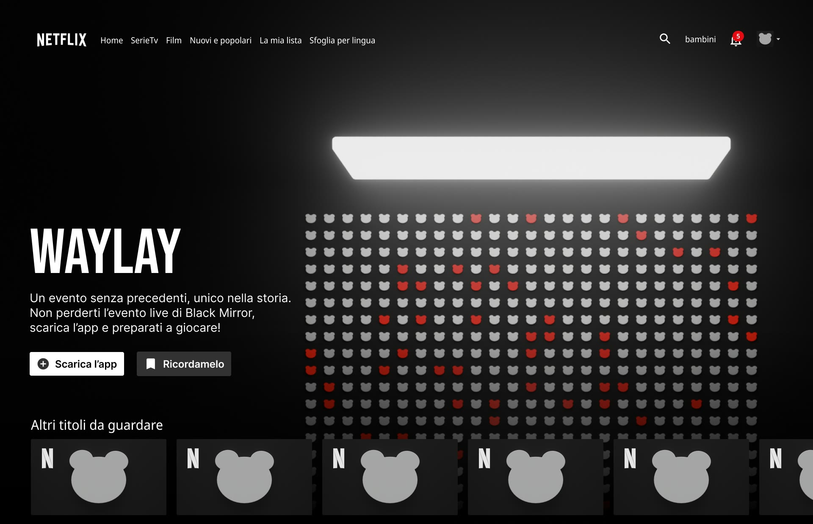
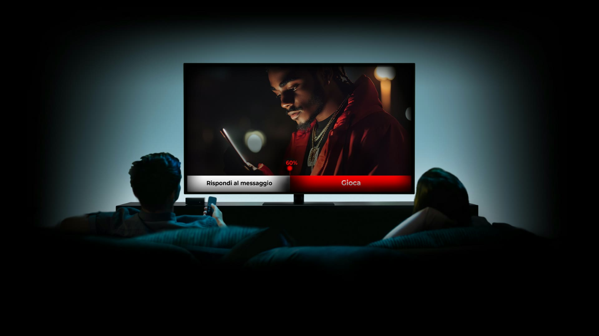
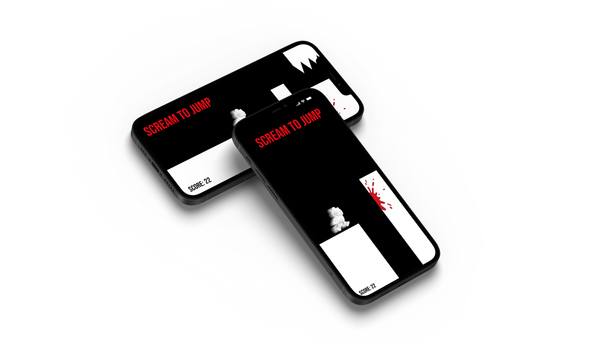
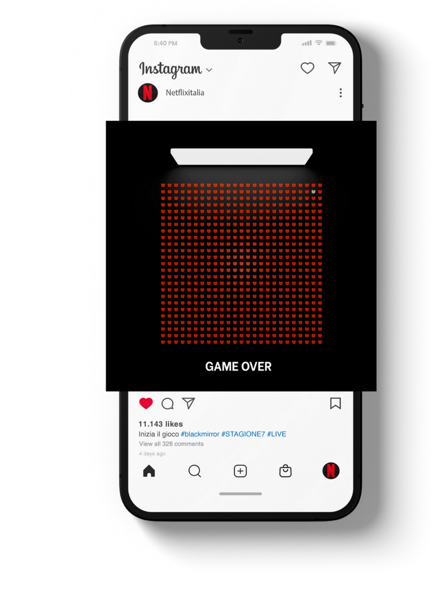
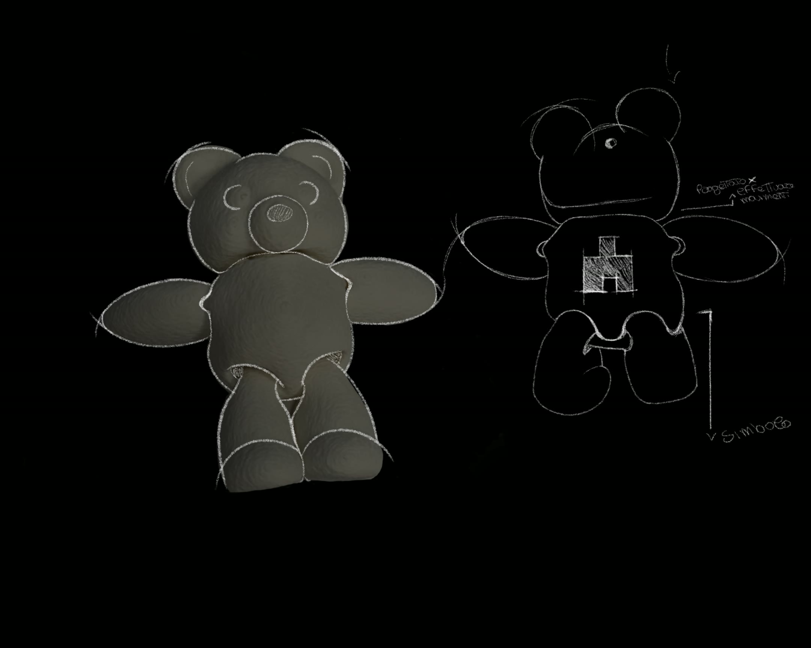
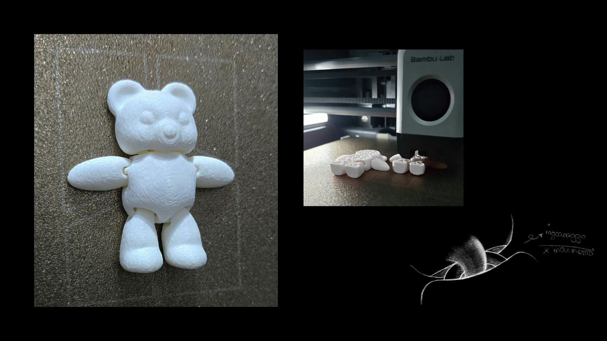

# A live event you'll die for.

> An academy brief: launch Black Mirror's seventh season. Our answer is WAYLAY, a live episode streamed once, never recorded.


Streaming took the risk out of watching. Miss an episode and it waits for you.

WAYLAY doesn't wait. The audience plays it from their phones, and can be thrown out of it.

## Before

Before launch, the teasers promise surprises. They don't say which.


On launch day, a new Netflix homepage, and an app made for the event. The phone is how you play.



## Live


The rules are on screen. All but one.

```logic
YOU                         THE EPISODE

                            live, once, never recorded
                            │
                            ▼
vote on your phone ◀─────── a choice for the character
│
└─────────────────────────▶ the story turns
                            │
                            ▼
play on your phone ◀─────── a mini-game, harder each time
│
├── pass ─────────────────▶ the story goes on
│
└── fail ─────────────────▶ ?
```





Each game is harder than the last. Sooner or later, you fail one.

==You learn you had three lives when you lose the first.==


Lose the third and you can't watch anymore. The episode goes on without you. It isn't recorded, so there is nothing to catch up on.


## After

Out of lives, viewers can only ask how it ends. We mocked up their posts.


One reply, translated from the Italian:

> We're all in the same boat. I lost my lives too, and now I'm here looking for spoilers.



The few still alive at the end see the finale. Then a keepsake arrives at their home: the bear.



We printed a prototype.




---

Academy project, AANT, BA in Art Direction. [index](../index.md)
