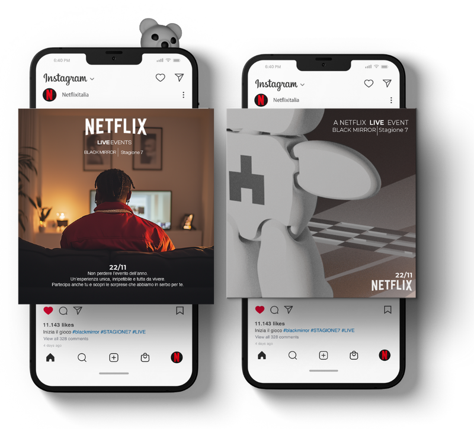
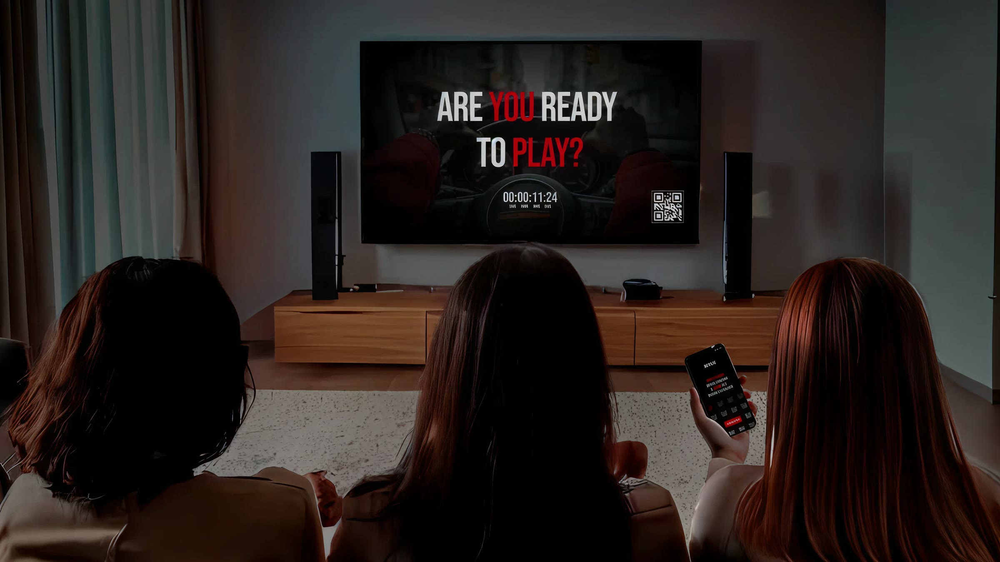
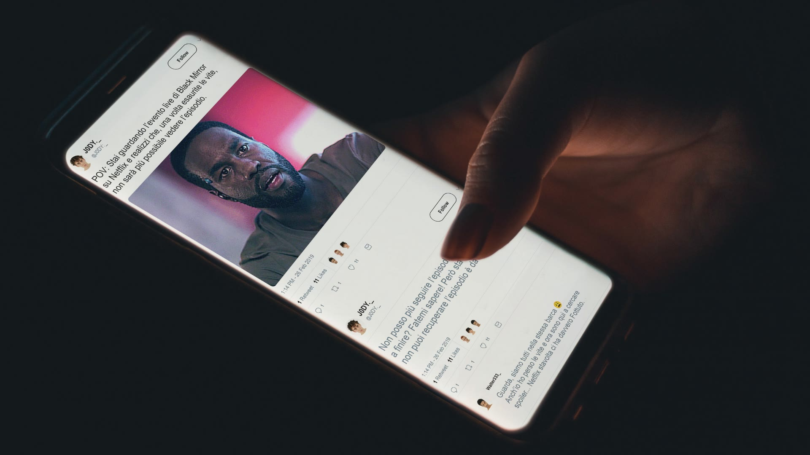

# A live event **you’ll die for.**

> An academy brief: launch Black Mirror’s seventh season. Our answer is WAYLAY, a live episode streamed once, never recorded.

## Streamed **once.**

Streaming took the risk out of watching. Miss an episode and it waits for you.

We designed one that doesn’t wait. Miss it and it’s gone. The audience plays it from their phones, and can be **thrown out** of it.

## Before it airs.

The teasers give a date and promise **surprises**. They don’t say which.

On launch day, the Netflix homepage would turn over to WAYLAY.

An app made for the event would turn every phone into a controller.

## Vote on the fate.

During the episode, the audience votes on what the character does next. The story turns with the vote.

## Then **risk it all.**

Some choices send the character into a mini-game, and the audience plays it on their phones.

Each game is harder than the last. Sooner or later, you **fail** one.

## With your own **lives.**

==You learn you had three lives when you lose **the first.**==

Lose the third and you **can’t watch anymore**. The episode goes on without you. It isn’t recorded, so there is nothing to catch up on.

## **Locked out.**

Out of lives, viewers could only ask each other how it ends. We mocked up their posts.

One reply, translated from the Italian:

> We’re all in the same boat. I lost my lives too, and now I’m here looking for spoilers. …

## For the survivors.

The few still alive at the end would see the finale. Then a keepsake would arrive at their home: the bear.

We printed a prototype.

---

Academy project, AANT, BA in Art Direction. [index](../index.md)
